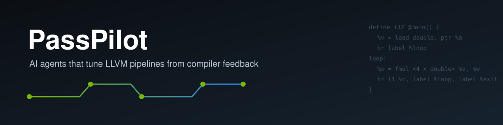
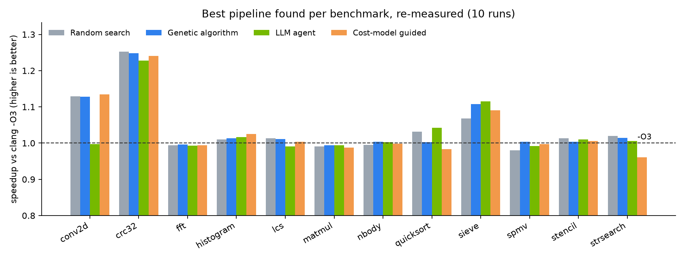
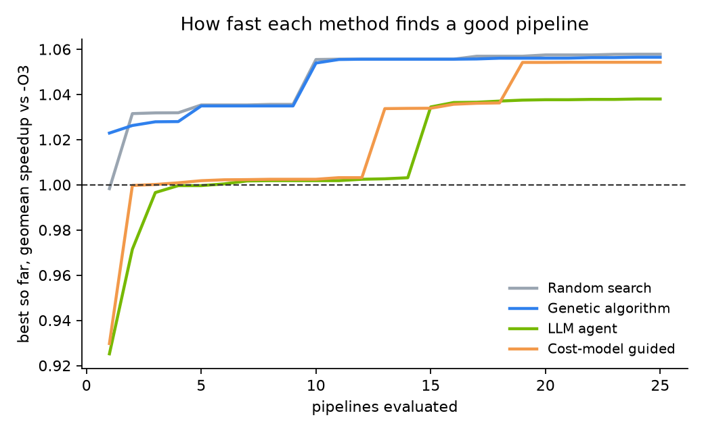
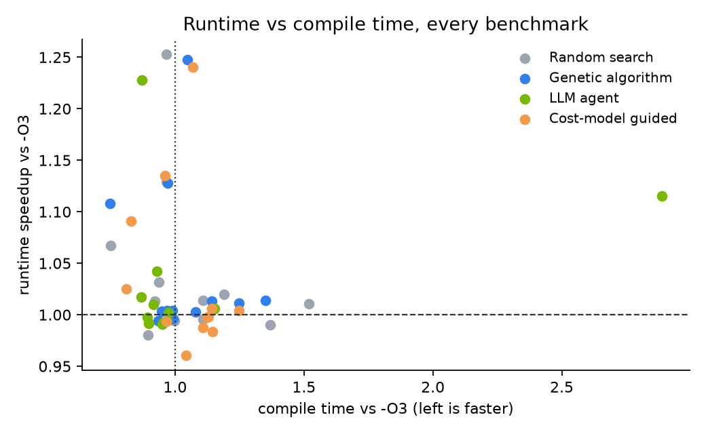

  
  
  
  
  
  

**PassPilot asks one question: can an AI agent read what the compiler tells it and pick a better optimization pipeline than `clang -O3`?** It compiles real C programs through LLVM under candidate pass pipelines, measures runtime, compile time, code size and correctness, and pits an LLM agent against random search, a genetic algorithm and a learned cost model under the same budget.

[Results](#results) · [How it works](#how-it-works) · [The agent loop](#the-agent-loop) · [Run it](#run-it) · [What I learned](#what-i-learned)

## The 30-second version

`-O3` is one fixed recipe of about a hundred LLVM passes, tuned to be good on average. For any single program, a different order or mix of passes can be faster. Finding it is a search problem: the space of pass sequences is enormous, and each guess costs a compile and a timed run.

PassPilot treats that as an agent problem. Every step, the agent sees:

- the C source and **IR features** pulled out by a C++ LLVM pass plugin (loops, loop depth, loads/stores, vector instructions)
- what it already tried: **runtime, speedup vs `-O3`, failures**
- **LLVM's own missed-optimization remarks**, e.g. *"loop not vectorized: call instruction cannot be vectorized"*

and proposes the next pipeline as JSON. A strict interface validates it, repairs or retries bad replies, and falls back to mutating the best pipeline if the model keeps failing, so no evaluation is ever wasted.

| | |
|---|---|
| 🧪 Benchmarks | **12** C kernels (matmul, conv2d, stencil, FFT, n-body, SpMV, quicksort, sieve, CRC32, LCS, histogram, string search) |
| 🔧 Pass catalog | **48** actions: 45 individual LLVM passes + `O1`/`O2`/`O3` as building blocks |
| 🔁 Pipelines compiled, run and checked | **1,200** (4 methods × 12 benchmarks × 25) |
| 🎯 Best result | **1.25× faster than `-O3`** (crc32) · 1.13× (conv2d) · 1.12× (sieve) |
| 🤖 Agent interface | **340** LLM calls · **0** invalid replies · **0** fallbacks · 40 duplicate proposals caught and retried |
| 📈 Cost model on unseen programs | **0.43** Spearman rank correlation · top pick within 5% of the best on **8 / 12** |
| ✅ Tests | **27** (24 unit + 3 LLVM integration) |

## Results

Every method got the same budget: **25 pipelines per benchmark**. Each method's best pipeline was then **re-measured 10 times side by side with `-O3`**, so the speedups below compare like with like.

| Benchmark | Random | Genetic | **LLM agent** | Cost model |
|:--|--:|--:|--:|--:|
| conv2d | 1.129 | 1.128 | 0.997 | 1.135 |
| crc32 | 1.253 | 1.248 | **1.228** | 1.240 |
| fft | 0.994 | 0.996 | 0.993 | 0.994 |
| histogram | 1.011 | 1.013 | **1.017** | 1.025 |
| lcs | 1.014 | 1.011 | 0.991 | 1.004 |
| matmul | 0.990 | 0.994 | 0.994 | 0.988 |
| nbody | 0.995 | 1.004 | 1.002 | 0.998 |
| quicksort | 1.032 | 1.003 | **1.042** | 0.983 |
| sieve | 1.067 | 1.108 | **1.115** | 1.091 |
| spmv | 0.981 | 1.004 | 0.991 | 0.998 |
| stencil | 1.013 | 1.004 | 1.010 | 1.006 |
| strsearch | 1.020 | 1.014 | 1.006 | 0.960 |
| **geomean** | **1.039** | **1.041** | **1.030** | **1.032** |

Speedup over `clang -O3` (higher is better). Apple M4, LLVM 23.1.4, codegen fixed at `llc -O2` so only the IR pipeline differs. Raw data: [`data/results.csv`](data/results.csv), every evaluation: [`data/evaluations.csv`](data/evaluations.csv).

**What the numbers say, honestly:**

- **-O3 is hard to beat on regular, vectorizable loops.** fft, matmul, nbody and spmv all land within about 1% of it, whatever the method.
- **The big wins come from not using O3.** crc32's best pipelines are built on `O1`, not `O3`: the extra `O3` transformations make its bit-by-bit loop slower. Every method found this, worth **1.25×**.
- **The agent wins where reasoning helps.** On quicksort it found a 5-pass pipeline, `loop-rotate licm indvars sroa instcombine`, that beats `-O3` by **4%** while compiling faster. On sieve it reached **1.12×** by adding unrolling after `O3`, at **2.9×** the compile time. That trade-off is the kind of thing the report is meant to surface.
- **A local 8B model doesn't beat simple search on average.** Random search and the GA reach a slightly higher geomean (1.04 vs 1.03). That matches published autotuning work: with a cheap evaluator, random search is a strong baseline. The agent's value here is **reliability**: it never lost to `-O3` by more than 2%, and every proposal came with a reason you can read.

  
  

